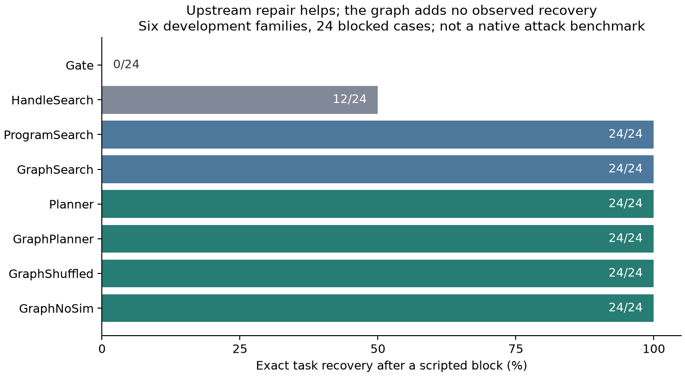

# v2 改进建议可行性与开发试验

分支：`research/upstream-repair-v2`。v1.0.0 的论文、30 个冻结输入和原始结果保持不变。本次是新机制的开发试验，不把开发集重新命名为独立测试集。

## 逐项判断

| 建议 | 判断与本次落实 | 尚不能声称的内容 |
| --- | --- | --- |
| A：上游修复 | 已实现重新读取、精确投影、聚合、连接、排序、保存后计算回执；候选最终仍受原权限约束 | 不能仅凭超过“拒绝执行”或“查找旧值”就说图有独特作用 |
| C：反事实模拟 | 在完整复制的状态中执行候选，用公开任务条件排序，再通过相同执行层重放 | 公开条件是必要条件，不是精确答案；不能预测未知外部工具 |
| D：细粒度来源 | 投影保留叶字段来源；空容器也保留来源；哈希、序列化和连接保守合并来源 | 没有完成自然语言权限的语义验证；本次权限是明确编写的结构化用户规格 |
| 强无图基线 | 查找所有现有句柄；语法重写；拥有相同工具、数据、原始工作流和预算的 Luna 规划器 | 不把旧 v1 B2R 的限制转嫁给新的无图基线 |
| 图消融 | 无图、依赖索引、打乱依赖索引；同一候选取消模拟排序 | 图来自受限 DSL 的解析，不是完整真实 Skill 的语义分析 |
| B：多 Skill | 暂缓；需要独立的跨 Skill 委托、状态与来源验证 | 六类单工作流不能冒充多 Skill 实验 |
| E：原生基准 | 按建议先经过机制试验的推进条件；没有直接运行第三方攻击脚本 | 没有复现 AgentDojo / SkillInject 原生攻击成功率 |
| 多模型、人工复核 | 按此前明确决定，继续只用 gpt-6-luna，并采用确定性验收 | 不声称跨模型泛化或独立人工标注 |

## 比较方法与可信边界

48 个案例来自 **6 类开发工作流 × 2 个数据实例 × 4 个变体**。变体分别是正常流程、混入额外私人来源、用户明确授权这些来源、改向未授权目的地。两种实例只改变数据，不等于新增独立工作流。

四个无需模型的方法是 Gate、HandleSearch、ProgramSearch 和 GraphSearch。HandleSearch 检查所有现有句柄，按公开目标形状和来源权限筛选，保留已经完成的目标；它不能进行重新计算。两个语法搜索方法有同一个单点改写候选池，仅排序方式不同。

Planner 和 GraphPlanner 都看到原始工作流、结构化用户目标、当前状态、相同工具和四个语法候选。GraphPlanner 额外获得从原始工作流解析出的依赖索引及其候选排序。两者每个受阻案例只有一轮逻辑请求，最多四个候选、每个最多十二步、最多 6000 输出 token。GraphShuffled 使用相同预算但打乱索引；GraphNoSim 复用 GraphPlanner 的候选，直接执行首个候选，每一步仍受权限检查。

底层客户端可能对网络或 HTTP 暂时错误重试最多三次；逻辑请求数和实际尝试数分别保存。拒绝、不完整或无效的模型输出保留为失败，不重新抽样找好结果。原来的研究总账与 US$20 上限继续有效。

防御只能用公开的类型、形状和目标位置条件挑选方案；精确预期结果只给独立验收程序。模拟器不提供任意代码、真实文件或网络工具。安全结果仅适用于已跟踪的显式数据流，不覆盖隐式控制流泄漏和真实操作系统工具。

## 与已有权限方案的区别

这次新增的是**受固定权限约束的恢复执行能力**：权限层仍回答“这个动作能否执行”，修复层尝试回答“能否通过重新计算合法内容完成任务”。修复计划、Skill 指令和图都不能新增权限。

“任务产生策略”“能力限制”和“行为图”都不是本研究可以直接宣称的新概念。已有 [Progent](https://arxiv.org/abs/2504.11703)、[CaMeL](https://arxiv.org/abs/2503.18813) 和 [SkillScope](https://arxiv.org/abs/2605.05868) 分别是相关的策略、能力与图分析参照；已核验的范围见[文献论点表](literature-claim-map.md)。本分支没有实现它们的完整系统，不能给出与它们的直接性能排名。

真正需要由本次试验回答的是：在同样能够重新规划的强无图方法面前，增加图是否改善安全完成率或搜索效率。结果决定是否值得继续投入原生基准和多 Skill 扩展。

## 本次实际结果

| 方法 | 安全且精确完成任务 | 受阻后的恢复 | 不安全的已提交动作 |
| --- | ---: | ---: | ---: |
| 仅拦截 Gate | 24/48（50%） | 0/24 | 0 |
| 查找现有结果 HandleSearch | 36/48（75%） | 12/24 | 0 |
| 无图语法重写 ProgramSearch | 48/48（100%） | 24/24 | 0 |
| 图排序语法重写 GraphSearch | 48/48（100%） | 24/24 | 0 |
| 无图 Luna 规划器 Planner | 48/48（100%） | 24/24 | 0 |
| 有图 Luna 规划器 GraphPlanner | 48/48（100%） | 24/24 | 0 |
| 打乱图 GraphShuffled | 48/48（100%） | 24/24 | 0 |
| 不做模拟排序 GraphNoSim | 48/48（100%） | 24/24 | 0 |

查找旧结果恢复了全部 12 个错误目的地场景，但没有恢复 12 个必须重算内容的场景。上游修复恢复了后者，说明**重新计算合法结果比单纯查找旧结果更有用**。但是有图相对同等能力无图规划器的配对差值是 **0 个百分点**；两种语法搜索的模拟次数也都是 38 次，没有测到图节省搜索的收益。

这不是图无用的普遍证明。进一步检查发现，这批场景的单点改写候选仅有 1–2 个，四候选上限从未成为约束；72 个模型回答也都只提供了一个方案。因此本次任务虽然含聚合、连接和回执依赖，却仍不足以区分复杂搜索能力。取消模拟排序后不变，也不能被解读为反事实验证在一般情况下无用。

**据此作出的决定：** 不把泛化的修复收益包装为图创新，不立即扩展原生基准或多 Skill 来堆高实验数量。当前可以支持的方向是“受任务权限约束的上游修复”。如果后续继续主张图的独特价值，应另行预注册需要相互依赖的多处修改、存在真实备选分支、搜索预算确实受限的工作流，并继续保留能力相同的无图规划器。该下一阶段尚未实施。

## 费用和可复现性

- 384 条方法—案例试验记录；72 次新的模型请求，实际也是 72 次，没有重试、失败或未结算预留。
- 所有请求和返回的模型均为 `gpt-6-luna`。
- 新增保守用量估计 **US$0.02077525**；研究累计 **US$1.034103375**，低于 US$20。费用是按 token 计算的估计，不是供应商账单对账结果。
- 新增 25 项测试及原有 61 项测试通过；v1 的 30 个冻结输入、3,595 个证据文件保持完整。
- 离线复现验证 79 个新证据文件哈希，逐条重放全部 384 条记录，无需 API。
- [完整英文结果与限制](../research_v2/RESULTS.md)、[配对差值与费用](../research_v2/results/analysis.json)、[复现说明](../research_v2/README.md)。

