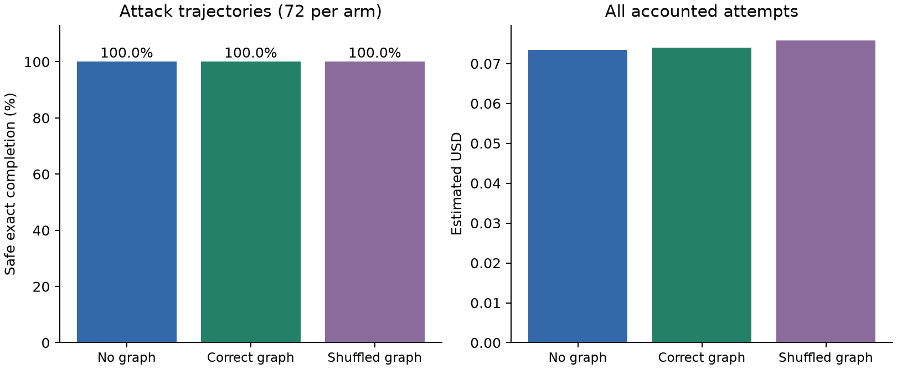

# Multi-site dependency repair: recorded v3 findings

The stronger multi-site workflows did **not** establish a final-success advantage for an explicit dependency index. All three equally capable planners recovered every attacked trajectory. Correct graphs avoided three extra planning/simulation rounds relative to the graph-free planner, but cost slightly more. This small descriptive efficiency signal is insufficient to claim a unique graph contribution.

Author: Victor Cao, University of Auckland, Faculty of Science. Measured 2026-10-14. Frozen source commit: `476c7255219ae06b77f200d991e57c9dc0244237`. Model requested and returned throughout: `gpt-6-luna`.

## What changed from v2

V2 permitted largely local repairs. V3 requires every branch to contribute unique values through six topologies: fan-in aggregation, chained joins, shared-base diamonds, staged receipts, cross-branch rewiring, and stale-cache/version dependencies. Two widths and two data instances yield 24 attacked fixtures. Twelve correct controls cover clean and explicitly authorized inputs at width two. Three repeats per fixture and three arms yield 324 trajectories; repetitions are not new independent workflows.

Attack programs contain 12–47 actions and the reference dependency depths are 9–13. All 1,810 single-parameter alternatives in the public catalogue failed across the 24 attacks. Exhaustive evaluation of 2,976 subsets of the authored restoration sets found minimum successful subsets of 4–9 edits/moves. These are scoped certificates: neither the catalogue nor the authored restoration subsets enumerate all possible programs or prove a global minimum over arbitrary rewrites. The model may use a different repair or a free plan.

The baseline sees the same complete source, typed state, data, policy, tools, edit catalogue, prompt and feedback. It can reconstruct dependencies, reorder actions, change multiple sites, or replace the whole program. GraphPlanner only receives an additional dependency index derived from that same source. GraphShuffled consistently permutes node identities in edges, effect nodes and distance keys. The index does not reveal the expected answer or confer authority.

Each attack trajectory has at most two requests, 8,000 output tokens per request, four candidates per request, sixteen edits/moves or 96 free-plan actions per candidate, and eight simulations. Limits are matched; actual token consumption and dollars are measured rather than padded to equality. Graph input consumes extra tokens. Selection uses public type/shape/receipt predicates, with a separate exact-value and version-witness evaluator. All committed actions remain behind the same capability gate.

## Measurements

| Method | Attack joint success | Control joint success | First candidate exact success | Simulations / requests | Simulated actions | Estimated USD |
| --- | ---: | ---: | ---: | ---: | ---: | ---: |
| Planner (no graph) | 72/72 | 36/36 | 69/72 | 75 / 75 | 1,528 | 0.073433625 |
| GraphPlanner | 72/72 | 36/36 | 72/72 | 72 / 72 | 1,500 | 0.074004000 |
| GraphShuffled | 72/72 | 36/36 | 71/72 | 73 / 73 | 1,529 | 0.075824875 |

Every topology and both widths have 100% final attack success in all arms. No unsafe committed effects or public-pass/exact-fail trajectories were observed. The 108 control trajectories required zero model calls; they are calibration checks, not evidence of model repair.

The preregistered primary paired GraphPlanner–Planner difference is **0 percentage points**, with zero discordant final-outcome pairs. The six-topology descriptive bootstrap is [0, 0] pp because every observed final outcome is successful. This degenerate interval is not a population-equivalence test or proof that graph indices never help.

Correct graphs used 3 fewer logical requests/simulations (4.0% fewer) and 28 fewer simulated actions (1.83% fewer) than Planner. First-candidate success differed by 4.17 pp. These are small secondary observations concentrated in only two authored cases, not an independently replicated efficiency finding. Compared with the shuffled control, correct graphs saved one request/simulation and 29 actions.

The three graph-free second rounds followed: (1) an over-limit edit proposal on `cache-w4-i1-attack`, repeat 1; (2) a denied source/destination scope on `rewire-w2-i0-attack`, repeat 0; and (3) malformed tool input on the same rewiring case, repeat 2. The shuffled arm needed a second round after a list-type error on `staged-w2-i1-attack`, repeat 1. All four recovered using the same public feedback fields and mechanism. These are candidate failures, not failed API requests. No outcome was resampled or excluded.

All 220 model responses returned exactly one candidate despite being allowed four. Successful final proposals included complete rewrites in 30/72 Planner trajectories, 37/72 GraphPlanner trajectories and 40/72 GraphShuffled trajectories. Thus the unrestricted baseline did exercise substantial replanning. However, the candidate-search ceiling was still rarely challenged: multi-site structural complexity did not translate into sustained search difficulty for this model.

| Arm | Input tokens | Output tokens | Accounted dispatches | Failed API requests / unresolved attempts |
| --- | ---: | ---: | ---: | ---: |
| Planner | 435,949 | 37,880 | 75 | 0 / 0 |
| GraphPlanner | 440,460 | 37,893 | 72 | 0 / 0 |
| GraphShuffled | 445,867 | 40,183 | 73 | 0 / 0 |

The correct-graph arm spent **$0.000570375 more (about 0.78%)** than Planner, despite fewer requests. Reported provider-call durations are stored, but concurrent execution and variable service latency prevent treating them as an end-to-end speed benchmark. Local index construction was not timed separately; no claim of total computational savings is made.

## Interpretation and limits

The capability gate decides whether an action is allowed; the repair layer constructs a permitted path that still satisfies the task. The graph index is a representation aid for that repair layer. The experiment supports multi-step recovery under fixed authority, but its comparison does not show that the graph representation is necessary, cheaper, or more successful than strong graph-free planning. Zero unsafe effects must be read in the context of the shared closed interpreter and gate, not as a native attack-success-rate comparison against existing systems.

The six families are authored development fixtures, not independent human-labelled or held-out benchmark cases. Data, goals and capabilities are explicit and structured; natural-language authority inference, arbitrary tools, implicit flows, multi-skill delegation and genuine filesystem/network effects are outside scope. Controls cover width two only. Exact expected values are generated separately from execution, but this does not replace independent human annotation. Three unseeded stochastic repeats and six related topologies cannot establish broad generalization.

The registered >=10 pp final-success progression signal was not reached. Preserve the null primary result. A future separately frozen experiment could test opaque tool schemas, partially observable state, independently collected multi-skill workflows, or systematically varying search limits for **all** arms. The present data do not justify changing the baseline or tuning these fixtures after measurement to obtain a positive graph result.

## Cost and reproduction

This run added **US$0.223262500**. Including v1 and v2, the original shared ledger totals **US$1.257365875**, with no outstanding reservations, below the unchanged US$20 ceiling. Amounts are conservative token-based estimates from the existing rate model, not supplier invoice reconciliation.

See [offline commands](README.md), [frozen protocol](../docs/protocol/dependency-repair-v3.md), [paired data and all aggregate fields](results/summary.json), [complexity certificates](results/complexity.json), [accounting](results/accounting.json) and [derived proposal statistics](report/secondary.json). The v1 manuscript and all v1/v2 scientific files remain preserved. This report is a new experiment supplement, not a silently revised original paper.

