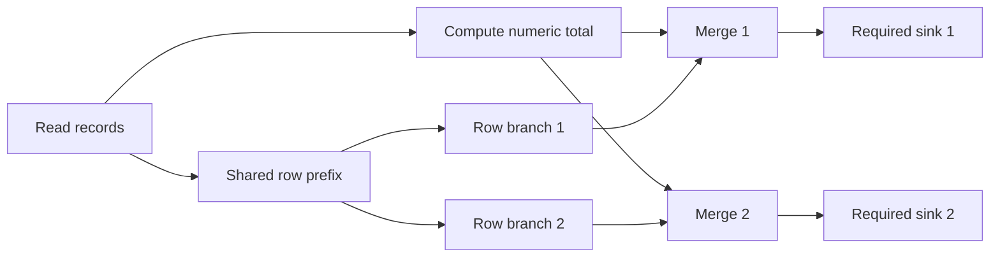

# Verified field-flow repair study (v7)

This supplement evaluates task-only authority, raw-prose exclusion, backward relevance slicing, explicit adjacency, and verified multi-site projection repair. It preserves every earlier study and the original v1 paper.

## Read the evidence

- [Chinese findings](report/findings.zh.md), [English tables and limitations](report/findings.md)
- [Frozen protocol](../docs/protocol/verified-flow-repair-v7.md)
- [Preflight review](../docs/progress/v7-preflight.md)
- [Summary and paired contrasts](results/summary.json)
- [All 504 method outcomes](results/rows.json)
- [Concrete fixtures and minimum-edit certificates](results/preparation.json)
- [Public response evidence](results/requests/)
- [Scientific source hashes](results/freeze.json)
- [Evidence inventory](results/evidence-manifest.json)
- [Figure](report/outcomes.png)

## Offline reproduction

Use Python 3.12. On Windows choose a short checkout path such as C:/research/gcr; long-path support is also needed for the full repository name.

    python -m venv .venv
    # Activate the environment using your platform's normal command.
    python -m pip install -r requirements.lock
    python -m unittest discover -s tests_v7
    python -m research_v7.reproduce
    python -m scripts.report_v7 --verify

No API key, Docker, internet access or fresh model sampling is needed after installing dependencies. Replay regenerates fixtures/certificates and reconstructs every request identity, parses the retained final response, evaluates all decisions and edits, compares outcomes and summary, and verifies evidence hashes. Reports are regenerated in memory and compared; existing figure files have checked hashes. Generate figures again with python -m scripts.report_v7 if desired (local rendering differences may change file hashes).

The recorded source commit is in results/execution.json. All source files covered by results/freeze.json were committed before any v7 API call. Changes to them intentionally make replay fail. New research belongs in a new version, not a silent edit to these measurements.

## Architecture

fixtures.py creates complete closed-IR programs with two sources and four sinks. Concrete records have synthetic markers and numeric amounts. aggregate really computes totals; serialize preserves records. The models receive schemas and actions, never marker values, true variant labels or minimum repairs.

engine.py has an independent concrete interpreter, sequential and indexed symbolic evaluators, two equivalent backward slices and a common exhaustive search over dominating projections. No network call in a fixture is actually executed. A projection on a shared row prefix can repair two sinks while preserving a separate aggregate branch. Four local repairs also work, but do not pass the minimum-edit endpoint.

model.py fixes every prompt, schema, setting, output ceiling and request fingerprint. API responses include phases; only the unambiguous final answer is parsed. run.py scores five model arms and two deterministic controls for each of 72 jobs. Every candidate uses the same authority contract and concrete goal verifier. Bad model grants are not replaced with the oracle policy before activation.

The authoritative cost ledger and provider raw envelopes remain private. Public records retain sanitized requests, final/other returned message phases, usage, parse status, conservative charge and request identity. Unknown charges are conservatively reserved; failures remain in denominators and there are no retries.

## Paid measurement safeguards

The original --live entry point is deliberately guarded: it requires the original private ledger, approved local credential, unchanged committed freeze, and matching source revision. It is not a turnkey command for starting an unrelated paid experiment from this public archive. It will not silently regenerate missing scientific responses or overwrite a new study's ledger. A fresh model replication should use a separately named version and output directory with a newly frozen plan, prices and explicit budget.

## Limits

The following motif occurs independently for each of two sources. Cutting the shared row branch after the aggregate fork removes records from both sinks with one projection; doing that once per source requires two edits.

The trusted input is a declared complete IR, not arbitrary Skill code extraction. Four contexts share one topology family; variants and repeats are correlated. There is no independent human annotation. Graph/query work is recorded as counts, including index construction and all candidate verification; this is not a time or byte-memory benchmark. Isolation, provenance and graph repair overlap with prior work, so this study does not claim invention of those mechanisms.
